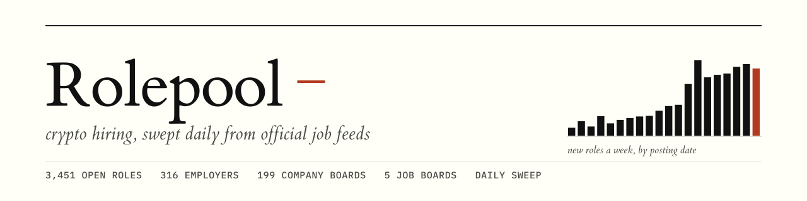
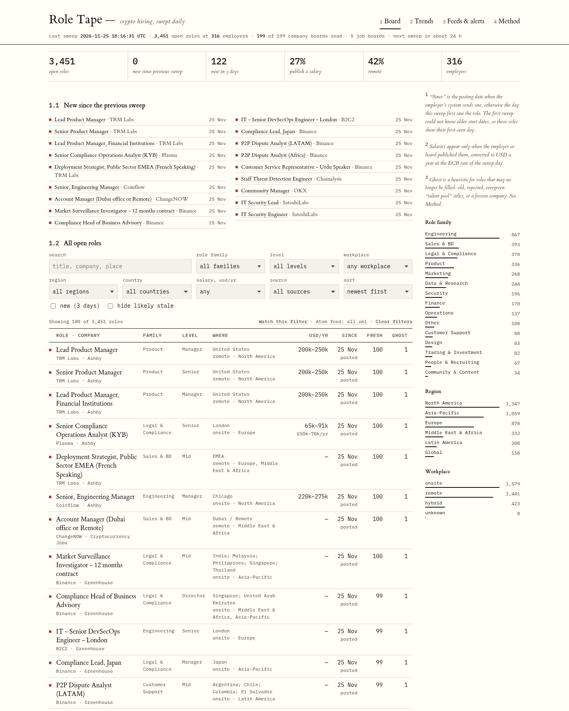
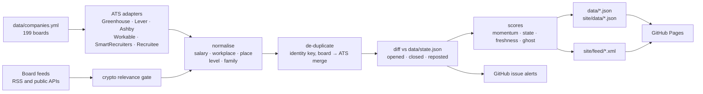

<p align="center">
  <picture>
    <source media="(prefers-color-scheme: dark)" srcset="docs/banner-dark.svg">
    <source media="(prefers-color-scheme: light)" srcset="docs/banner-light.svg">
    
  </picture>
</p>

<h3 align="center">Every open crypto role, every role type, swept once a day from the source.</h3>
<p align="center">Engineering to legal, support to trading. Official ATS feeds and public job-board feeds, one schema, one formula layer, one static site.</p>

<p align="center">
  <a href="https://prafullj0shi.github.io/role-tape/"></a>
  <a href="#latest-sweep"></a>
  <a href="#sources"></a>
  <a href="tests"></a>
  <a href="LICENSE"></a>
</p>

<p align="center">
  <a href="https://prafullj0shi.github.io/role-tape/"><b>Open the board</b></a> ·
  <a href="#formulas">Formulas</a> ·
  <a href="#pipeline">Pipeline</a> ·
  <a href="#feeds-and-alerts">Feeds and alerts</a> ·
  <a href="DESIGN.md">Design</a>
</p>

<p align="center">
  
</p>

## What it is

A daily sweep of crypto and web3 hiring, worldwide and across every role family. It reads each company's own applicant tracking system through the public job-board API that system publishes, adds crypto job boards and remote boards that offer an RSS feed or API, merges duplicates, and keeps a history so it can say who is hiring and who has gone quiet.

- **Board.** Every open role with filters for role family, level, workplace, region, country, published salary (USD a year) and source. New roles carry an accent mark; likely-stale roles can be hidden.
- **Trends.** Each company's Hiring Momentum score, state (hiring, steady, cooling, frozen, check board), open-role count, opens and closes over 7 and 30 days, and a sparkline of weekly opens.
- **Feeds and alerts.** Atom feeds for all roles, each family, each region, remote roles, roles with a salary and company state changes; GitHub issue alerts; a saved filter in the browser.
- **Method.** Every formula on the site, written out, with its limits.

> [!NOTE]
> "First seen" is not "posted". The sweep only knows a role's real start date when the employer's system sends one (Greenhouse, Lever, Ashby, Workable, SmartRecruiters and Recruitee all do). Salary appears only when the employer or board published it.

## Latest sweep

Real run on 25 Nov 2026, 18:16 UTC (baseline plus one follow-up sweep):

| Figure | Value |
| :--- | ---: |
| Open roles after de-duplication | 3,451 |
| From company boards / from job boards | 3,171 / 280 |
| Employers | 316 |
| Company boards read / failed | 199 / 0 (34 read but empty) |
| Roles with a published salary | 942 (27%) |
| Roles with an employer posting date | 3,412 (99%) |
| Duplicates merged | 157 exact on company boards, 160 job-board items folded into the company's own posting |
| Run time | about 70 s, 227 requests |

Role families: Engineering 867, Sales & BD 392, Legal & Compliance 378, Product 336, Marketing 268, Data & Research 244, Security 196, Finance 170, Operations 137, Customer Support 88, Design 83, Trading & Investment 82, People & Recruiting 67, Community & Content 34, Other 108.

Workplace: on-site 1,578, remote 1,441, hybrid 423. Regions: North America 1,347, Asia-Pacific 1,058, Europe 878, Middle East & Africa 332, Latin America 208, Global (remote, no place) 158.

## Sources

**Company boards** (`data/companies.yml`, 199 live boards). 147 board tokens come from the public company list of [crypto-jobs-fyi/crawler](https://github.com/crypto-jobs-fyi/crawler); 44 more were found by `scripts/discover.py`, which probed about 500 extra crypto firms on each ATS and kept a board only when at least a quarter of its postings read as crypto; 8 were added by hand after review (`scripts/manual_boards.yml`). Mixed companies (Robinhood, Block, Stripe, Jump Trading, a16z, Hut 8, Swissquote, NinjaTrader) carry `filter: crypto`, so only their crypto postings count.

| ATS | Public API | Boards | Roles |
| :--- | :--- | ---: | ---: |
| Greenhouse | `boards-api.greenhouse.io/v1/boards/{token}/jobs?content=true` | 63 | 1,669 |
| Ashby | `api.ashbyhq.com/posting-api/job-board/{org}?includeCompensation=true` | 90 | 832 |
| Lever (US and EU) | `api.lever.co/v0/postings/{company}?mode=json` | 34 | 419 |
| Recruitee | `{company}.recruitee.com/api/offers/` | 2 | 202 |
| Workable | `apply.workable.com/api/v1/widget/accounts/{account}` | 9 | 49 |
| SmartRecruiters | `api.smartrecruiters.com/v1/companies/{id}/postings` | 1 | 0 after crypto filter |

**Job boards and hiring feeds** (`app/sources/boards.py`). Terms checked against each site's robots.txt and API notes on 25 Nov 2026.

| Board | Feed | Read | Kept as crypto | New after merge | Terms followed |
| :--- | :--- | ---: | ---: | ---: | :--- |
| Cryptocurrency Jobs | RSS `cryptocurrencyjobs.co/index.xml` | 42 | 42 | 23 | public feed, link back |
| CryptoJobsList | RSS `api.cryptojobslist.com/jobs.rss` | 100 | 100 | 39 | public feed, link back |
| Himalayas | API `himalayas.app/jobs/api/search` | 309 | 289 | 211 | public API, link back, few pages per query |
| Remote OK | API `remoteok.com/api?tags=crypto` | 7 | 6 | 4 | link back and name Remote OK |
| Remotive | API `remotive.com/api/remote-jobs?search=crypto` | 16 | 3 | 3 | at most 4 calls a day, link back, name Remotive |

Recruiting firms show up through these boards (for example King Deux Search, Tokalent, Nextweb Talent on Himalayas). Twelve crypto recruiters were probed for their own public boards; none had one with crypto postings.

**Not used**, by design: LinkedIn, Indeed, Glassdoor, Wellfound and any site whose terms forbid automated collection; web3.career and other boards that need an API key; HTML scraping of careers pages.

**Politeness.** One User-Agent that names the project, at most 2 requests a second per host, retries with back-off on 429 and 5xx (honouring `Retry-After`), an ETag / `If-Modified-Since` cache, and one sweep a day.

## Pipeline



One entry point (`python -m app.sweep`), run by `.github/workflows/sweep.yml` at 03:17 UTC every day. The workflow runs the tests, sweeps, commits `data/`, `site/data/` and `site/feed/`, posts alert digests and deploys `site/` to Pages.

## Formulas

All thresholds live in `app/config.py`; every formula has tests in `tests/test_scoring.py`, `tests/test_dedupe.py` and `tests/test_detect.py`.

### 1. Canonical job and identity key (`app/dedupe.py`)

```text
url'     = https + lower(host) + path without trailing "/", minus utm_*, gh_src, ref, source, lever-source, fbclid, gclid
key      = sha1( company~ | title~ | place )[0:16]
company~ = lower(name) − legal suffix (Inc, Ltd, GmbH, AG …) − TLD (.com, .io, .xyz …), letters and digits only
title~   = lower(title) − (bracketed text) − {remote, hybrid, full-time, contract …}
           with sr→senior, jr→junior, eng→engineer, &→and
place    = sorted country codes (max 3) | "remote" | "any"
```

Exact key matches collapse. A job-board item is folded into a company's own posting when the company names match after also dropping words such as *Labs*, *Foundation* or *Network*, and the normalised titles are equal or have token Jaccard ≥ 0.85. The company posting wins; the board goes to `also_on`.

### 2. Detection (`app/detect.py`, `app/geo.py`)

- **Salary.** Structured fields first (Ashby compensation, Lever `salaryRange`, Recruitee, Remote OK, Himalayas); else the first currency-marked range in the listed salary text or the description (`$120,000 – $150,000`, `€80k–100k`, `CHF 120'000`, `12–18 LPA`, `₹25,00,000`). Period from nearby words; annualised with hour × 2080, day × 260, week × 52, month × 12; converted to USD at the ECB reference rate of the sweep day (Frankfurter API, no key); dropped outside 8k–1.5M USD.
- **Workplace.** The ATS field when present; otherwise *hybrid*, *remote / anywhere / worldwide / distributed* or *on-site* in title or location; a named place without those words is on-site; nothing at all is unknown.
- **Country and region.** Countries, US states and about 220 cities map to ISO codes and then to North America, Latin America, Europe, Middle East & Africa or Asia-Pacific; EMEA, APAC, LATAM and similar add regions; remote with no place is Global.
- **Level.** Title rules in order: Intern, Executive, Director, Staff+, Manager, Senior, Entry, Mid (no marker reads as Mid).
- **Role family.** Fifteen families from ordered title rules (security before engineering, design before product, sales engineer before engineer), then the department name, else Other.
- **Crypto relevance** (general boards and mixed companies only). Distinct strong terms (blockchain, stablecoin, DeFi, on-chain, Solidity …) score 1, weak ones (wallet, token, protocol …) 0.5; keep at ≥ 2.

### 3. Opened, closed, reposted (`app/tracking.py`)

```text
opened     key present now and absent (or closed) in state
closed     key open in state, absent now, AND its source fetched without error this sweep
repost     a key reopens within 90 days of closing → reposts + 1
opened_at  ATS posting date if sent, else first-seen time; unknown for roles already open at a board's first sweep
```

A board that fails never produces closes; its roles stay open and the company shows CHECK-BOARD.

### 4. Hiring Momentum, H (`app/scoring.py`)

```text
r_d   = (O_d − C_d) / max(N_{d−1}, 5)                         daily net-open rate
M     = Σ_{a=0..29} w_a · r_{t−a} / Σ w_a,  w_a = 2^(−a/7)       30-day decayed mean, 7-day half-life
x     = asinh(M / 0.01)                                        tames the long right tail
z_own = (x − mean(x_hist)) / (sd(x_hist) + 0.05)               against the company's own past
z_xs  = (x − median(x_all)) / max(1.4826 · MAD(x_all), 0.5)    against every company today
s     = n / (n + 14)                                           n = days of own history
z     = s · z_own + (1 − s) · z_xs,  clipped to [−6, 6]
H     = 100 · tanh(z / 3)                                      −100 … +100
```

O_d counts roles whose `opened_at` falls on day d, so employer posting dates fill the first weeks; C_d counts closes the sweep saw. On day one H is purely cross-sectional; after 14 daily sweeps the company's own history carries half the weight.

### 5. Freeze detector

```text
CHECK-BOARD  board failed this sweep, or fell to 0 open after > 0 (until 2 zero sweeps in a row)
FROZEN       board read fine and 0 roles open (after the CHECK-BOARD grace)
             or days since a new role ≥ 21 AND open ≤ 70% of its 30-day max
             or days since a new role ≥ 60
HIRING       H ≥ 25 AND new roles in 7 days ≥ 2
COOLING      H ≤ −25, or net 30-day opens < 0 AND days since a new role ≥ 10
STEADY       everything else
```

Checked top to bottom. Every change is written to `data/flips.json` and `site/feed/flips.xml`. First sweep: 35 hiring, 81 steady, 83 frozen (35 boards with no open crypto role and 48 whose newest posting is over 60 days old).

### 6. Freshness and ghost-job score

```text
age  = now − opened_at   (first seen when opened_at is unknown)
F    = 100 · e^(−age / 30)

G    = 100 · (1 − Π (1 − p_i))
p_age       = 0.6 · σ((age − 60) / 15)
p_repost    = min(0.5, 0.25 · reposts)
p_evergreen = 0.5 for "general application", "talent pool", "future opportunities" …
p_thin      = 0.15 for a company posting with under 300 characters of description
p_company   = 0.3 if the company is FROZEN, 0.15 if COOLING
bands: < 25 low · 25–50 watch · ≥ 50 likely stale
```

G is a heuristic, not a verdict.

## Feeds and alerts

- **Atom feeds** in `site/feed/`: `all.xml`, `family/{family}.xml` (15), `region/{region}.xml` (6), `remote.xml`, `salary.xml`, `flips.xml`. Up to 200 entries each, newest first.
- **GitHub issue alerts.** One open issue per role family (`Alerts: Engineering` …, label `alerts`). After each scheduled sweep `python -m app.alerts` posts that day's new roles as a comment using the workflow's built-in token. Subscribe to an issue to get them; no secret or paid service involved.
- **Saved filter.** *Watch this filter* on the board keeps the filter in local storage and, on the next visit, reports how many matching roles are new.

## Data files

| File | What |
| :--- | :--- |
| `data/companies.yml` | boards swept: name, ATS, token, kind, origin, optional `filter: crypto` |
| `data/jobs.json` | every open role with all detected fields and scores |
| `data/companies.json` | per-company metrics, momentum and state |
| `data/history.json` | one row per day: totals, by family, by region, per-company open / opened / closed / M / H |
| `data/state.json` | first seen, last seen, closed, reposts, opened_at per identity key (closed keys kept 120 days) |
| `data/health.json`, `data/meta.json` | per-board fetch status, per-source counts, run stats |
| `site/data/*.json` | compact copies for the browser |

## Run it locally

```bash
python -m venv .venv && . .venv/bin/activate
pip install -r requirements.txt
python -m pytest                 # 103 tests, no network
python -m app.sweep              # full sweep, about a minute
python -m app.sweep --limit 20   # quick check on the first 20 boards
python -m http.server -d site 8000
python -m app.alerts --dry-run   # print the alert digests
```

Rebuild the board list with `python -m scripts.discover` (plus `python scripts/tidy_companies.py`), the README banner with `python scripts/make_readme_art.py` and the screenshots with `python scripts/screenshots.py`.

## Limits

- First seen is not posted; before the first sweep only the employer's posting date is known, and roles that closed before then are invisible (the posting-date backfill reads low for older weeks).
- Firms on custom careers sites, Workday, Rippling or Gem boards (Circle, Base, Gate, dYdX, Dragonfly, Sygnum, LMAX, Bitcoin Suisse, World and others) are covered only when they post on the job boards.
- The crypto filter on mixed companies and general boards is keyword-based; it can miss a role that never names the field and can let a forex or fintech role through.
- Rules are English-first.
- Momentum and freeze states sharpen as daily history accumulates; the first two weeks lean on the cross-section.

## Credits

- Inspired by [crypto-jobs-fyi/crawler](https://github.com/crypto-jobs-fyi/crawler) (Apache 2.0). Its public company list seeded the board tokens; no code was copied. This project is independent code under MIT.
- Listings belong to their employers and to [Cryptocurrency Jobs](https://cryptocurrencyjobs.co/), [CryptoJobsList](https://cryptojobslist.com/), [Himalayas](https://himalayas.app/), [Remote OK](https://remoteok.com/) and [Remotive](https://remotive.com/); every link goes to the original posting.
- Fonts: [ET Book](https://github.com/edwardtufte/et-book) (MIT) and [IBM Plex Mono](https://github.com/IBM/plex) (OFL). FX: European Central Bank reference rates via [Frankfurter](https://frankfurter.dev/).

## License

[MIT](LICENSE)
